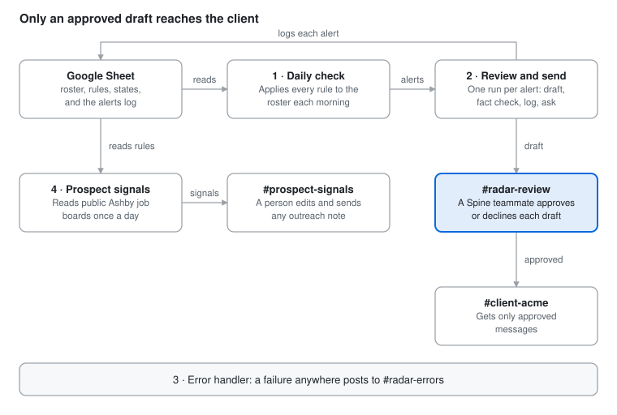
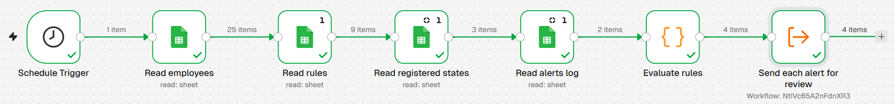
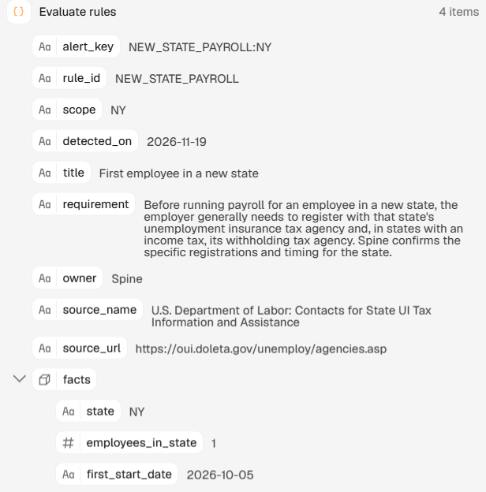
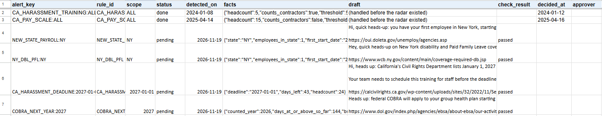
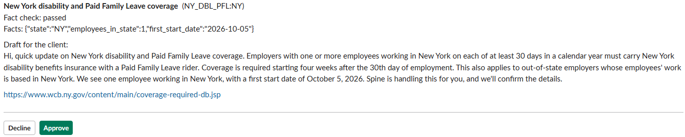
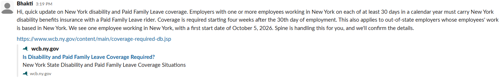

# Compliance Radar

An n8n automation that watches a startup's employee list and flags new compliance requirements before they're missed. Claude drafts a plain-English heads-up, code fact-checks the draft, and nothing reaches the client until a person approves it in Slack.

I built it as a portfolio project for Spine's AI & Operations Associate role, with a lot of help from Claude.

> **Demo only.** It runs on a made-up 24-person company. The rules are simplified and would need review by a qualified person before real use. This is not legal advice.

## How it works



| Workflow | What it does |
| --- | --- |
| 1 · Daily check | Each morning, reads the roster, the rules, the registered states and the alert log, then works out which rules newly apply |
| 2 · Review and send | Runs once per alert. Claude drafts a message, code fact-checks it, the alert is logged, and a teammate approves or declines it in Slack |
| 3 · Error handler | Posts any failure in the other workflows to `#radar-errors` |
| 4 · Prospect signals (bonus) | Watches startups' public Ashby job boards and flags a company posting a role in a new state |

## See it run

**The daily check.** 25 employees, 9 rules, 3 registered states and 2 past alerts go in, and 4 new alerts come out.



**One alert.** It carries the rule's own text, its owner, its official source and the facts that triggered it. That's everything the model sees. No names are included.



**The alert log.** Each alert is logged with its draft, the fact-check result and its source link. It stays `pending` until someone approves it.



<!-- Add more screenshots here, for example:


-->

## Design choices

- **The model explains but never decides.** Code decides which rules apply. Claude only rewrites the rule's own text.
- **Every draft gets a fact check.** Code flags any number that isn't in the rule or the facts, any draft missing its source link, and any alert that arrives empty.
- **A person approves every message.** Nothing reaches the client without an Approve click in Slack.
- **Rules are data.** Each rule is a row in a sheet with a link to its official source, so adding a rule means adding a row.
- **No names go to the model, and every alert is logged.** The model sees only counts, states and dates.

## The rules

| Rule | Fires when | Source |
| --- | --- | --- |
| `NEW_STATE_PAYROLL` | Someone works in a state where payroll isn't registered, or starts there within 45 days | [U.S. Department of Labor](https://oui.doleta.gov/unemploy/agencies.asp) |
| `NY_DBL_PFL` | At least one employee works in New York | [NY Workers' Compensation Board](https://www.wcb.ny.gov/content/main/coverage-required-db.jsp) |
| `COBRA_FEDERAL` | Last year had 20+ employees on more than half its business days | [U.S. Department of Labor](https://www.dol.gov/index.php/agencies/ebsa/about-ebsa/our-activities/resource-center/publications/an-employers-guide-to-group-health-continuation-coverage-under-cobra) |
| `COBRA_NEXT_YEAR` | This year has already crossed that line, so COBRA applies next year | [U.S. Department of Labor](https://www.dol.gov/index.php/agencies/ebsa/about-ebsa/our-activities/resource-center/publications/an-employers-guide-to-group-health-continuation-coverage-under-cobra) |
| `ACA_ALE` | Last year averaged 50+ full-time employees and equivalents | [IRS](https://www.irs.gov/affordable-care-act/employers/determining-if-an-employer-is-an-applicable-large-employer) |
| `ACA_ALE_WATCH` | This year's average so far is 40 or more (a heads-up) | [IRS](https://www.irs.gov/affordable-care-act/employers/determining-if-an-employer-is-an-applicable-large-employer) |
| `CA_HARASSMENT_TRAINING` | 5+ people, contractors included, with at least one in California | [California Civil Rights Department](https://calcivilrights.ca.gov/wp-content/uploads/sites/32/2022/11/Sexual-Harassment-Prevention-Training-For-Employers-FAQ_ENG.pdf) |
| `CA_HARASSMENT_DEADLINE` | The same condition, with the January 1, 2027 deadline within 60 days | [California Civil Rights Department](https://calcivilrights.ca.gov/wp-content/uploads/sites/32/2022/11/Sexual-Harassment-Prevention-Training-For-Employers-FAQ_ENG.pdf) |
| `CA_PAY_SCALE` | 15+ employees, with at least one in California | [California Labor Commissioner](https://www.dir.ca.gov/dlse/California_Equal_Pay_Act.htm) |

The engine treats weekdays as "typical business days" and ignores holidays. It also estimates monthly hours for the ACA from weekly hours.

## Run it yourself

You'll need an n8n instance (an n8n Cloud trial works), a Google account, a test Slack workspace, and an Anthropic API key. On n8n Cloud, the Anthropic node can use n8n's Gateway credits instead of a key.

1. Upload `data/compliance-radar-starter.xlsx` to Google Drive, open it, and choose **File > Save as Google Sheets**. Keep the tab names as they are.
2. In each file in `workflows/`, replace `PASTE_YOUR_SHEET_URL` with your sheet's link.
3. In Slack, create `#radar-review` (private), `#client-acme`, `#radar-errors` and `#prospect-signals`, and invite your n8n app to each one.
4. Import each workflow into a new, empty n8n workflow, in this order: `radar-3-error-handler.json`, `radar-2-review-and-send.json`, `radar-1-daily-check.json`, `radar-4-prospect-signals.json`.
5. Open each node that shows a warning, and pick your Google Sheets, Slack and Anthropic credentials and the Slack channel.
6. In **Radar – Daily check**, set **Send each alert for review** to **Radar – Review and send**.
7. In workflows 1, 2 and 4, set **Settings > Error workflow** to **Radar – Error handler**.
8. Publish workflows 3, 2, 1 and 4, in that order. Then run **Radar – Daily check** from the editor.

Run on the starter data on 2026-11-19, the radar finds four alerts: `NEW_STATE_PAYROLL:NY`, `NY_DBL_PFL:NY`, `COBRA_NEXT_YEAR:2027` and `CA_HARASSMENT_DEADLINE:2027-01-01`. On a different date, the results will differ.

## Tests

`node tests/run-tests.js` runs the rules engine and the fact check against the starter data. There's nothing to install.

## What's in this repo

```
workflows/    the four n8n workflows, ready to import
code/         the JavaScript inside the Code nodes, for reading and testing
data/         the starter workbook with the made-up company
docs/         the architecture diagram
screenshots/  screenshots from a real run
tests/        a Node test script and the starter data as JSON
```

## What's next

- **Prospect signals.** Workflow 4 is included. It points the same rules at public job boards and drafts a note for a person to review and send.
- **An MCP layer.** n8n's MCP Server Trigger could let Claude, or anyone on the team, ask the radar what's coming up for a client.
- **Real rosters.** Read employee lists from a client's HR system instead of a sheet.
- **More rules.** Workers' comp in each new state, FMLA, EEO-1 reporting, and other states' pay transparency laws.

## Built with

n8n, Google Sheets, Slack and Claude.
